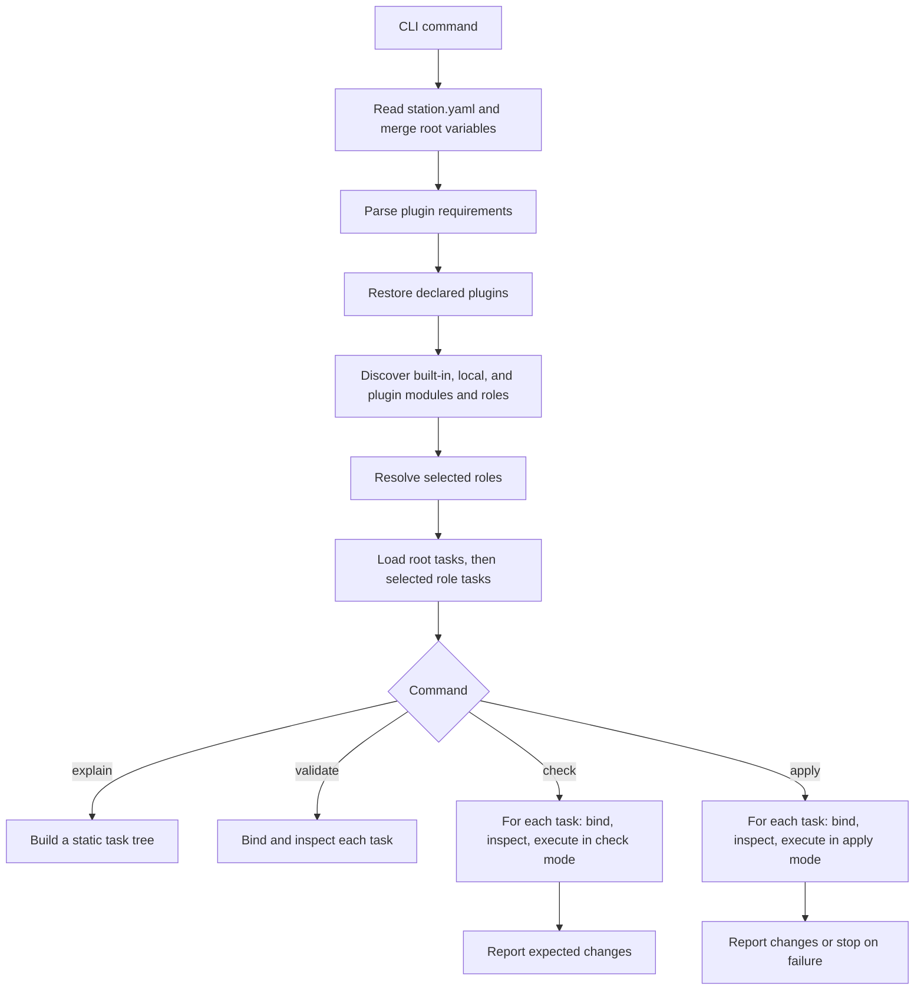

# Station execution flow

See the [English guide](docs/guide/development.md) or [Russian guide](docs/ru/guide/development.md) for the current architecture and commands.

`restore` ends after plugin restoration. `list roles` and `list modules` restore plugins and report available components without loading selected role tasks.
